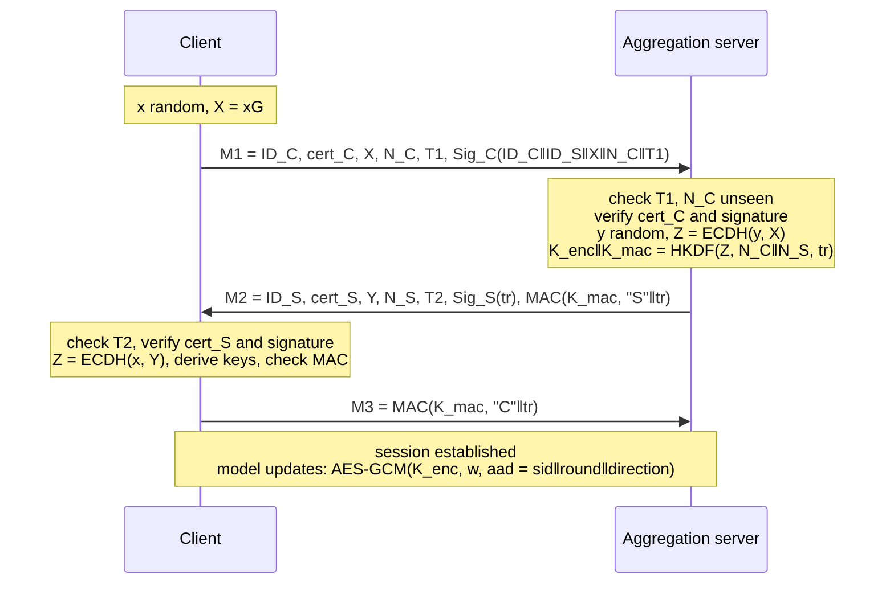

# FL-SecureAuth

**Mutual authentication and key agreement for federated learning**, implemented in Python, attack-tested, and modelled for formal verification in ProVerif.

Federated learning keeps raw data on the clients, but the channel between clients and the aggregation server is still an attack surface: a fake client can poison the global model, a rogue server can harvest updates, and an eavesdropper can run inference attacks on intercepted gradients. This project secures that channel with a lightweight elliptic-curve protocol that runs once per training session, then protects every model update with authenticated encryption.

```
$ python demo.py
  hospital-1   authenticated, session dcce6b861063...
  hospital-5   REJECTED
  round 8: 4 updates aggregated, test accuracy = 0.956
  [server] round 3: rejected update from intruder (no session)
  13/13 attacks blocked
```

## Features

- **Three-message handshake** with mutual authentication, ephemeral ECDH, HKDF key derivation and explicit key confirmation
- **Perfect forward secrecy**: ephemeral secrets are discarded after each handshake
- **Replay protection** with timestamps and a nonce cache; **revocation** through the registration authority
- **Encrypted FedAvg**: every model update is sealed with AES-256-GCM, bound to the session, the round and the direction
- **13 executable attack scenarios**, all blocked, run as unit tests
- **ProVerif model** covering secrecy, injective agreement, an insider attacker and long-term key compromise
- Fast: under **0.5 ms** of computation per side and **635 bytes** of total handshake traffic

## Protocol

| Symbol | Meaning |
|---|---|
| `RA` | Registration authority (offline, trusted) |
| `cert_X` | `Sig_RA(ID_X ‖ PK_X ‖ expiry)` |
| `x, y` | Ephemeral ECC secrets; `X = xG`, `Y = yG` |
| `N_C, N_S`, `T1, T2` | Fresh nonces and timestamps |
| `tr` | `H(M1 ‖ ID_S ‖ Y ‖ N_S ‖ T2)`, the transcript hash |



**Primitives:** NIST P-256, ECDSA-SHA256, ECDH, HKDF-SHA256, HMAC-SHA256, AES-256-GCM (all from [`cryptography`](https://cryptography.io)).

## Security analysis

Every row below is an executable test in [`src/fl_auth/attacks.py`](src/fl_auth/attacks.py).

| Attack | Defence | Result |
|---|---|---|
| Replay of M1 | Nonce cache | Blocked |
| Delayed message | Timestamp window (±5 s) | Blocked |
| MITM replacing the client's ephemeral key | `X` is covered by the client's signature | Blocked |
| MITM replacing the server's ephemeral key | `Y` is in the transcript signed by the server | Blocked |
| Certificate from an untrusted RA | RA signature check | Blocked |
| Impersonation with a stolen certificate | Attacker cannot sign with the victim's key | Blocked |
| Revoked client | RA revocation list | Blocked |
| Rogue aggregation server | Server must present an RA certificate and sign | Blocked |
| M1 redirected to a different server | Server ID is inside the client's signature | Blocked |
| Forged key confirmation | HMAC under the derived key | Blocked |
| Tampered model update | AES-GCM authentication tag | Blocked |
| Old update replayed into a later round | Round number in the associated data | Blocked |
| Update from an unauthenticated node | No session, no key | Blocked |

### Formal verification

[`protocol/fl_aka.pv`](protocol/fl_aka.pv) models the protocol for ProVerif 2.x against a Dolev-Yao attacker who also controls a registered malicious client and, in a later phase, learns the long-term keys of the honest client and server. Queries:

1. Secrecy of model updates sent under the session key (including after long-term key compromise, i.e. forward secrecy)
2. Injective agreement: server completes ⇒ client ran with the same identities and ephemeral keys
3. Injective agreement: client completes ⇒ server ran with the same identities and ephemeral keys

```bash
proverif protocol/fl_aka.pv
```

## Performance

Median of 200 runs on a single CPU core (Python 3.13). Reproduce with `python benchmark.py`.

| Primitive | Time (ms) |
|---|---|
| ECDSA sign | 0.027 |
| ECDSA verify | 0.081 |
| ECDH | 0.053 |
| Key generation | 0.016 |
| HKDF | 0.006 |

| Handshake | Value |
|---|---|
| Client computation | 0.44 ms |
| Server computation | 0.43 ms |
| M1 / M2 / M3 | 282 / 319 / 34 bytes |
| Total communication | 635 bytes |

| Model update (65×10 float64) | Value |
|---|---|
| Plaintext | 5,328 bytes |
| Encrypted | 5,356 bytes (+0.5%) |
| Encryption time | 0.019 ms |

Securing each update costs 28 bytes (IV + tag) and microseconds, so the protection is effectively free compared with local training.

## Quick start

```bash
git clone https://github.com/engmohammad2209-debug/fl-secure-auth.git
cd fl-secure-auth
pip install -r requirements.txt

python demo.py                               # full walkthrough
python -m unittest discover -s tests -v      # 18 tests
python benchmark.py                          # cost measurements
```

## Project structure

```
fl-secure-auth/
├── src/fl_auth/
│   ├── crypto_utils.py   # ECC, ECDSA, ECDH, HKDF, HMAC, AES-GCM wrappers
│   ├── protocol.py       # RA, certificates, client/server handshake
│   ├── federated.py      # FedAvg with encrypted updates
│   └── attacks.py        # 13 attack scenarios
├── protocol/fl_aka.pv    # ProVerif model
├── tests/                # unit tests (unittest / pytest compatible)
├── demo.py
└── benchmark.py
```

## Limitations and future work

- Parties run in one process; a real deployment would carry the messages over gRPC or WebSockets (for example inside a [Flower](https://flower.ai) strategy).
- Timestamps assume loosely synchronised clocks; the nonce cache should be bounded by the timestamp window in production.
- The protocol authenticates participants but does not stop an *authenticated* client from sending a poisoned model. Combining it with robust aggregation (Krum, trimmed mean), secure aggregation or differential privacy is the natural next step.
- This is a research prototype and has not been independently audited.

## Background

Based on the master's thesis *"Design and analysis of an authentication and key agreement protocol for use in a federated learning environment"* by Mohammad Matni.

## License

MIT
